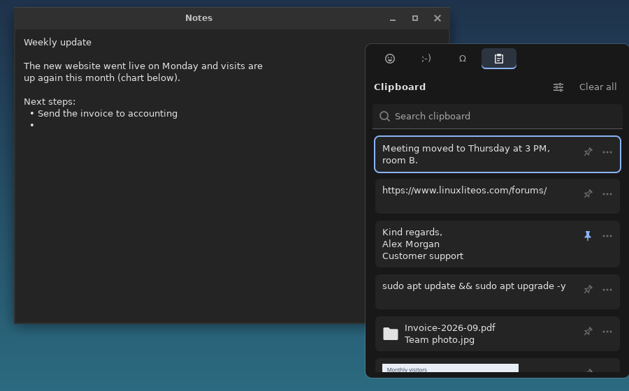
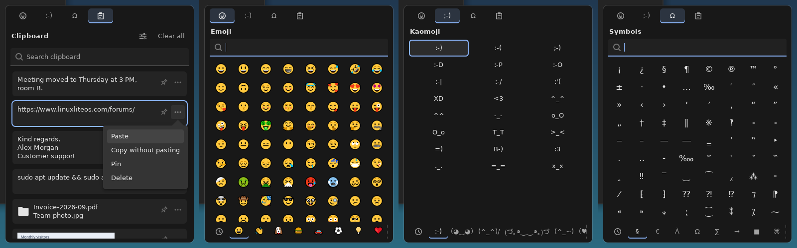
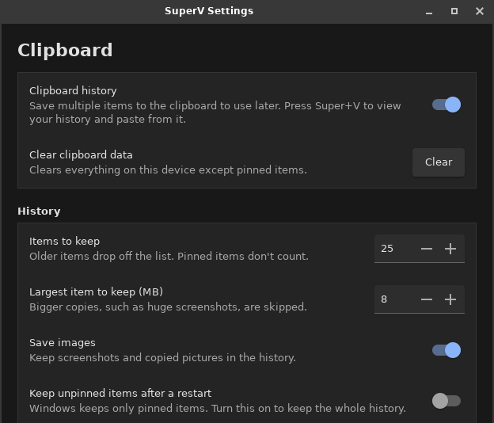

# SuperV

[](https://github.com/MilanG-Ne/superv/actions/workflows/ci.yml)


[](LICENSE)

**Windows' Win+V clipboard history, for Linux Lite.**

Press <kbd>Super</kbd>+<kbd>V</kbd> to see the last things you copied, text and images, and paste any of them into the app you're using. Pin the ones you use all the time and they're still there after a reboot. Emoji, kaomoji and symbols are one tab away, just like on Windows 11.

SuperV is free, open source and runs entirely on your computer. It needs nothing that Linux Lite doesn't already have: Python 3 and GTK 3.



## Install

**Linux Lite, Ubuntu, Mint, Debian and other .deb systems.** Download `superv_1.0.0_all.deb` from the [latest release](https://github.com/MilanG-Ne/superv/releases/latest), then:

```sh
sudo apt install ./superv_1.0.0_all.deb
```

Open **SuperV Clipboard** from the menu once (or log out and back in). On Xfce, <kbd>Super</kbd>+<kbd>V</kbd> and <kbd>Super</kbd>+<kbd>.</kbd> are set up automatically the first time SuperV starts.

**Without root, for your user only:**

```sh
git clone https://github.com/MilanG-Ne/superv.git
cd superv
./install.sh
```

The script installs to `~/.local`, starts SuperV at login, registers the shortcuts, and starts it right away. `sudo ./install.sh --system` installs it for every user instead.

**Just try it** from the checkout, without installing anything:

```sh
python3 bin/superv start
python3 bin/superv toggle
```

## Use it

| Keys | What happens |
| --- | --- |
| <kbd>Super</kbd>+<kbd>V</kbd> | Open or close clipboard history |
| <kbd>Super</kbd>+<kbd>.</kbd> | Open the emoji panel |
| <kbd>↑</kbd> <kbd>↓</kbd> or the mouse | Choose an item |
| <kbd>Enter</kbd> or click | Paste it into the app you were using |
| <kbd>Shift</kbd>+<kbd>Enter</kbd> | Paste as plain text (drops formatting) |
| <kbd>Ctrl</kbd>+<kbd>P</kbd> | Pin or unpin |
| <kbd>Delete</kbd> | Remove the item |
| <kbd>Menu</kbd> or **⋯** | More options: paste, paste as plain text, copy without pasting, pin, delete |
| Just type | Search |
| <kbd>Ctrl</kbd>+<kbd>Tab</kbd> | Next tab (emoji, kaomoji, symbols, clipboard) |
| <kbd>Esc</kbd> | Clear the search, then close |

Clicking outside the panel closes it. Terminals get <kbd>Ctrl</kbd>+<kbd>Shift</kbd>+<kbd>V</kbd> automatically, since that's how they paste.



## What it does, compared with Windows

| Windows 11 (Win+V) | SuperV |
| --- | --- |
| Text, HTML and images in the history | ✅ Also file lists copied in Thunar or another file manager, which paste back as files |
| Keeps the last 25 items | ✅ 25 by default; you can change it. Pinned items don't count |
| Skips items over 4 MB | ✅ 8 MB by default, so large screenshots fit; you can change it |
| Pinned items survive a restart; the rest is cleared | ✅ Same, with an option to keep everything |
| Click an item to paste it | ✅ |
| **⋯** menu: Delete, Pin, Paste as text | ✅ Plus "Copy without pasting" |
| Clear all (pinned items stay) | ✅ |
| Turn history on or off; Win+V offers to turn it on | ✅ |
| Emoji, kaomoji and symbols tabs, recently used | ✅ Emoji your fonts can't draw are hidden instead of showing boxes |
| GIF tab | ❌ It needs an online GIF service |
| Sync across devices | ❌ Everything stays on this computer |

Linux extras:

- **Search** the history by typing.
- **Keeps the clipboard when an app closes.** On Linux, copied text normally vanishes when you close the app you copied it from. SuperV puts it back.
- **Ignores passwords.** Anything KeePassXC and other password managers mark as secret is never saved.
- Optional notification-area icon, pinned-first sorting, and panel position (at the mouse or screen center).

## Settings

Open **SuperV Settings** from the menu, the gear in the panel, or `superv settings`. The page is modelled on Windows' Settings > System > Clipboard.



## Privacy

- No network access, no telemetry, no accounts.
- Unpinned history lives in `$XDG_RUNTIME_DIR/superv`, which is in memory and emptied when you log out or reboot. Pinned items live in `~/.local/share/superv`. Settings are in `~/.config/superv`. All files are readable only by you.
- Turning clipboard history off clears the unpinned items, like on Windows.

## Command line

```text
superv toggle [--tab emoji|kaomoji|symbols|clipboard]   what Super+V runs
superv show | hide | settings | clear | quit
superv status                          is it running, how many items, and so on (JSON)
superv start                           start in the background if it isn't running
superv setup-shortcuts | remove-shortcuts
superv autostart on|off
```

## Other desktops

SuperV works on any X11 desktop: MATE, Cinnamon, LXQt, KDE Plasma on X11, GNOME on Xorg. Outside Xfce, add the shortcut yourself: in your desktop's keyboard settings, create a custom shortcut that runs `superv toggle` and give it <kbd>Super</kbd>+<kbd>V</kbd>. GNOME already uses <kbd>Super</kbd>+<kbd>V</kbd> for its notification list, so free it up first or pick another key.

Wayland isn't supported yet. Wayland doesn't let apps watch the clipboard in the background or paste into other windows, which SuperV needs.

## Troubleshooting

- **<kbd>Super</kbd>+<kbd>V</kbd> does nothing.** Run `superv status`. If it's running, look for `<Super>v` in Settings > Keyboard > Application Shortcuts, or run `superv setup-shortcuts`.
- **Items show up twice, or the clipboard acts strangely.** Another clipboard manager (Clipman, Parcellite, Diodon, CopyQ) is probably running. Turn it off.
- **Pasting doesn't work in one app.** Turn off "Paste automatically" in Settings. Picking an item then only copies it, and you paste with <kbd>Ctrl</kbd>+<kbd>V</kbd>. Please [open an issue](https://github.com/MilanG-Ne/superv/issues) naming the app.
- **Emoji look like empty boxes.** Install a color emoji font: `sudo apt install fonts-noto-color-emoji`.

## Uninstall

```sh
superv remove-shortcuts        # removes Super+V and Super+. from Xfce
sudo apt remove superv         # if you installed the .deb
./uninstall.sh                 # if you used install.sh; add --purge to delete your pins and settings
```

## Development

```sh
python3 -m unittest discover -s tests -v      # unit tests, no display needed
xvfb-run -a python3 tests/smoke_test.py       # starts the real daemon on a virtual X server
packaging/build-deb.sh                        # builds dist/superv_<version>_all.deb
```

| File | What it does |
| --- | --- |
| `superv/monitor.py` | Watches the clipboard, captures copies, serves history items back |
| `superv/store.py` | The history, pins, and what survives a reboot |
| `superv/popup.py`, `superv/pickers.py` | The Super+V panel and the emoji, kaomoji and symbols tabs |
| `superv/x11.py` | Finds the active window and presses Ctrl+V in it (XTest, through ctypes) |
| `superv/desktop.py` | Xfce shortcuts and autostart |
| `superv/__main__.py`, `superv/ipc.py` | The `superv` command, which talks to the running daemon over a Unix socket |

Bug reports and pull requests are welcome.

## License

MIT, see [LICENSE](LICENSE). The emoji list is generated from Unicode's `emoji-test.txt` (Unicode License v3) by `tools/gen_emoji.py`.
